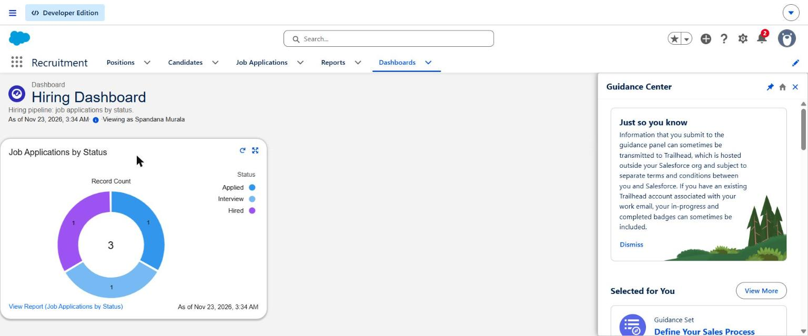

# Recruitment Management App (Salesforce)

A hiring tracker built on the Salesforce Platform using **point-and-click tools only** (no code): custom objects, validation rules, a record-triggered Flow, and a report + dashboard.

---

## What it does

- Tracks **Positions** (open jobs), **Candidates** (people applying), and **Job Applications** (a candidate applying for a position).
- Blocks bad data with **3 validation rules**.
- When an application's status changes, a **Flow** emails the hiring manager automatically.
- When a candidate is **Hired**, the Flow **closes the Position automatically**.
- A **Hiring Dashboard** shows how many applications are at each stage.

---

## Data model

| Object | Key fields | Notes |
|---|---|---|
| **Position** | Position Title, Status (Open/Closed), Department, Hiring Manager Email | Parent object |
| **Candidate** | Candidate Name, Email (required), Phone, Years of Experience | |
| **Job Application** | Application Number (auto: `JA-0001`), Position, Candidate, Status (Applied → Interview → Offered → Hired / Rejected) | Junction between Position and Candidate |

**Relationships**
- Job Application → Position: **Master-Detail** (an application can't exist without a position; deleting the position deletes its applications).
- Job Application → Candidate: **Lookup** (looser link; deleting a candidate doesn't delete the application).

---

## Validation rules

| Object | Rule | Formula | Error message |
|---|---|---|---|
| Job Application | `Hired_Only_After_Offered` | `AND(ISPICKVAL(Status__c,"Hired"), OR(ISNEW(), AND(ISCHANGED(Status__c), NOT(ISPICKVAL(PRIORVALUE(Status__c),"Offered")))))` | A candidate must be Offered before they can be Hired. |
| Candidate | `Experience_Not_Negative` | `Years_of_Experience__c < 0` | Years of Experience cannot be negative. |
| Position | `Open_Position_Needs_Manager_Email` | `AND(ISPICKVAL(Status__c,"Open"), ISBLANK(Hiring_Manager_Email__c))` | Please add a Hiring Manager Email for an open position. |

---

## Automation: `Job Application Status Update` (Record-Triggered Flow)

- **Runs on:** Job Application, **after save**, when a record is **updated**
- **Entry condition:** `Status__c` **Is Changed** = True (so it only runs when the status actually changes)
- **Steps:**
  1. **Send Email** to `{!$Record.Position__r.Hiring_Manager_Email__c}` with the application number and new status.
  2. **Decision — Is Hired?** → if `Status = Hired`:
  3. **Update Records** → set the related Position's `Status = Closed`.

---

## Reporting

- **Report:** *Job Applications by Status* (report type: Positions with Job Applications and Candidate), grouped by Status.
- **Dashboard:** *Hiring Dashboard* with a donut chart of applications by stage.

---

## Tested scenarios

| Test | Result |
|---|---|
| Save an Open position with no manager email | ✅ Blocked by validation rule |
| Save a candidate with −1 years of experience | ✅ Blocked by validation rule |
| Create a new application directly as "Hired" | ✅ Blocked by validation rule |
| Change status Applied → Offered | ✅ Email sent to hiring manager |
| Change status Offered → Hired | ✅ Email sent **and** Position auto-closed |

---

## Interview cheat-sheet

**"Walk me through this project."**
> I built a recruitment app on Salesforce with three custom objects: Position, Candidate and Job Application. Job Application is the junction — master-detail to Position and lookup to Candidate. I added validation rules to protect data quality, a record-triggered flow that emails the hiring manager whenever an application's status changes and automatically closes the position when someone is hired, and a dashboard showing the hiring pipeline.

**"Why master-detail for Position but lookup for Candidate?"**
> An application has no meaning without a position, so master-detail makes it required and cascades deletes. A candidate can exist on their own and apply to many positions, so a lookup is enough.

**"Why 'Is Changed' as the entry condition?"**
> So the flow only runs when the status actually changes, not on every edit. It saves resources and avoids sending duplicate emails.

**"Why 'Actions and Related Records' instead of 'Fast Field Updates'?"**
> Fast Field Updates (before-save) can only update the record that triggered the flow. My flow sends an email and updates a *different* record (the parent Position), so it has to run after save.

**"What does PRIORVALUE do?"**
> It returns the field's value before the current edit. I use it to check that the status was "Offered" before it changes to "Hired".

**"What would you add next?"**
> An approval process before an offer is made, a candidate-facing email template, and Apex test coverage if the logic moved to code.
